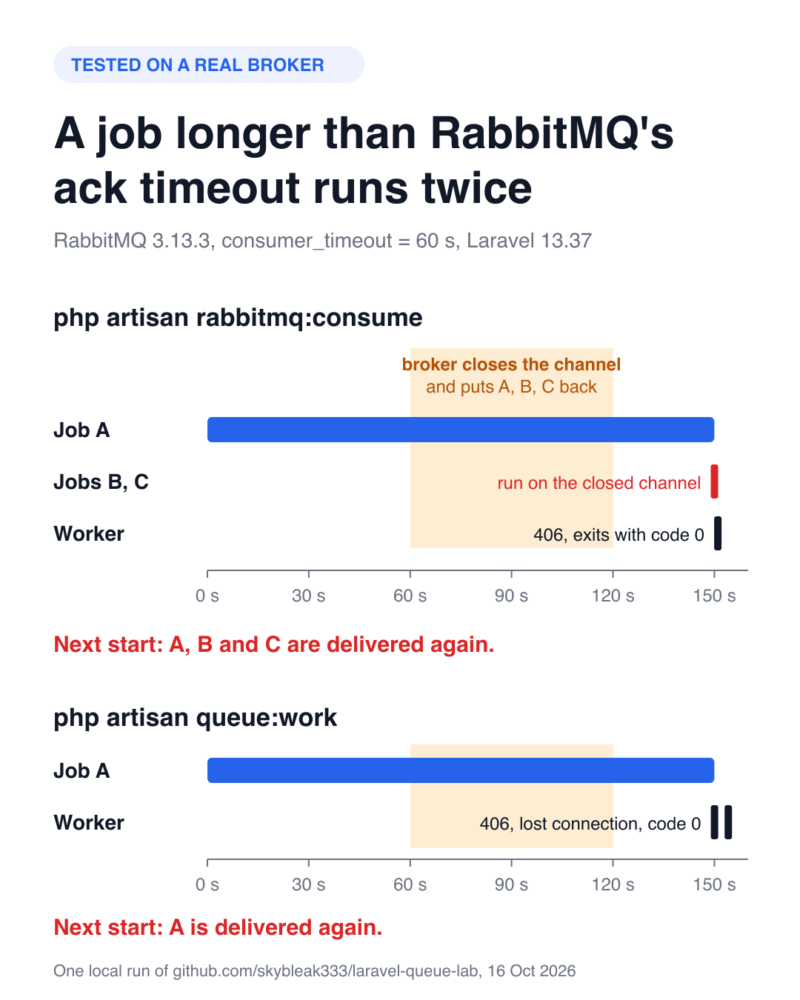
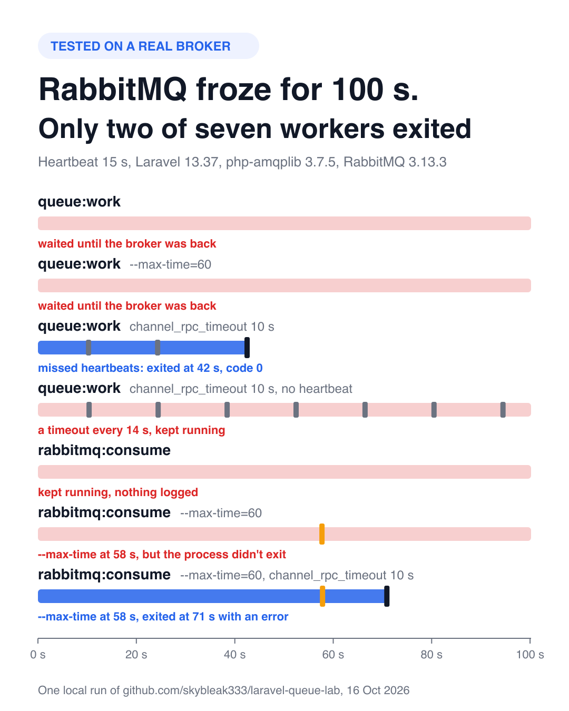
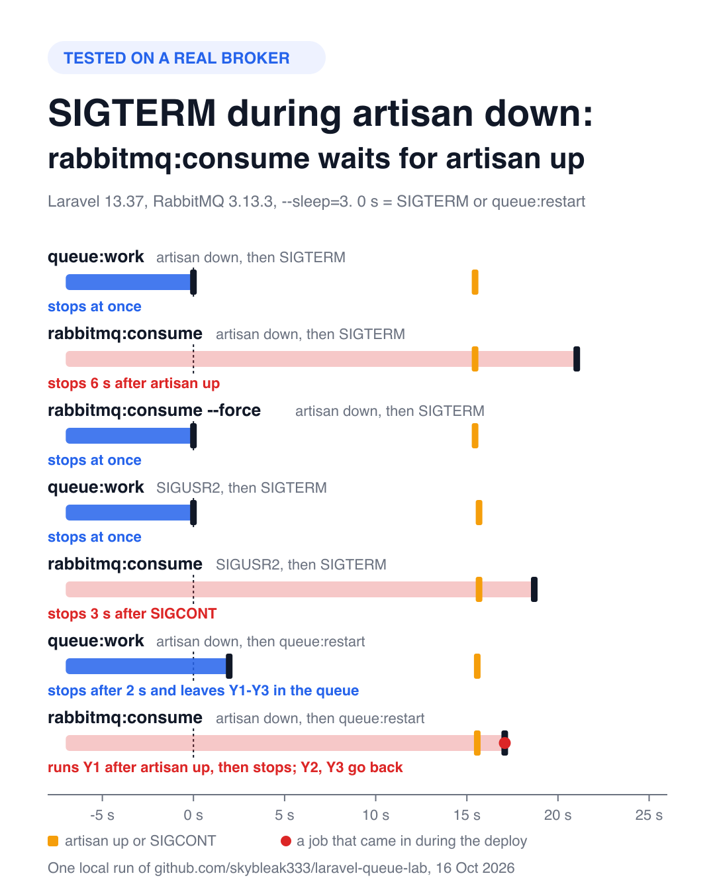

# laravel-queue-lab

[](https://github.com/skybleak333/laravel-queue-lab/actions/workflows/experiments.yml)

Reproducible experiments with Laravel queue workers against a real message broker. Each experiment is a PHPUnit test that starts real workers, records what they do and checks the result, so you can rerun it on your own versions. CI reruns them every week.

What the experiments found, with `queue:work` and `rabbitmq:consume` from [vyuldashev/laravel-queue-rabbitmq](https://github.com/vyuldashev/laravel-queue-rabbitmq):

- **[A job outlives RabbitMQ's acknowledgement timeout.](#experiment-1-a-job-that-outlives-rabbitmqs-acknowledgement-timeout)** The workers don't hang: they exit with code 0, and the job runs twice. With `rabbitmq:consume` and the default prefetch, the jobs already in the client buffer run twice too.
- **[The broker stops answering.](#experiment-2-a-broker-that-stops-answering)** With the default timeouts, `queue:work` waits until the broker is back, even with heartbeats on, and `--timeout` doesn't help. `rabbitmq:consume` doesn't notice at all.
- **[A worker is paused or the app is in maintenance mode.](#experiment-3-a-worker-that-is-paused-or-in-maintenance-mode)** `rabbitmq:consume` ignores SIGTERM and `queue:restart` until the pause ends, then runs one more job before it stops. While it is paused, it holds messages that other workers can't take, and it ignores `queue:pause`. `queue:work` stops at once on SIGTERM and within `--sleep` on `queue:restart`.

## Experiment 1: a job that outlives RabbitMQ's acknowledgement timeout

RabbitMQ closes a channel with `PRECONDITION_FAILED` (406) when a delivery stays unacknowledged for longer than [`consumer_timeout`](https://www.rabbitmq.com/docs/consumers#acknowledgement-timeout), 30 minutes by default. What do `php artisan queue:work` and `php artisan rabbitmq:consume` from [vyuldashev/laravel-queue-rabbitmq](https://github.com/vyuldashev/laravel-queue-rabbitmq) do when a job runs longer than that?

[Issue #664](https://github.com/vyuldashev/laravel-queue-rabbitmq/issues/664) in the package reports that the worker stays alive and stops consuming. On the versions below the worker exits instead, and some jobs run twice.

### Setup

- RabbitMQ 3.13.3 with `consumer_timeout = 60000` ([`rabbitmq/ack-timeout.conf`](rabbitmq/ack-timeout.conf)). The broker checks the timeout about once a minute, so it closes the channel 60–120 s after the delivery.
- One queue per scenario: job A, which sleeps 150 s on its first delivery, then quick jobs B and C.
- Workers run with `--timeout=600`, so Laravel's own job timeout stays out of the way, and `--max-time=420`, so a worker that hangs shows up as a long run.
- After a worker exits, `queue:work --stop-when-empty` drains its queue and records which messages were delivered again.

### Result

| Scenario | What happens after A finishes | Exit code | Delivered again |
|---|---|---|---|
| `queue:work` | The next `pop()` gets the 406 and the one after it `Lost connection: Channel connection is closed.` The worker stops with reason `LostConnection` 4 s later | 0 | A |
| `rabbitmq:consume` | B and C, already in the client buffer, run on the closed channel. Then the 406 arrives from `wait()`, the consume loop ends and the process exits without `WorkerStopping` | 0 | A, B and C |
| `rabbitmq:consume --prefetch-count=1` | The 406 arrives from `wait()` and the process exits | 0 | A |



Nothing hangs. The cost is duplicate work: the ack sent when A finishes goes to a channel the broker has already closed, so A runs again. With the default prefetch, B and C run twice as well.

### Why

- On a `basic.consume` channel the broker returns the unacknowledged messages to the queue as soon as the timeout fires, while the client is still running A ([`rabbit_channel.erl`](https://github.com/rabbitmq/rabbitmq-server/blob/v3.13.3/deps/rabbit/src/rabbit_channel.erl), `handle_exception` and `notify_queues`). With `basic_get`, which `queue:work` uses, the message goes back once the client answers the channel close.
- The client learns about the closed channel only on its next read. php-amqplib then marks the channel closed and clears its consumer callbacks, which ends the `rabbitmq:consume` loop. `queue:work` keeps the closed channel object: the next `basic_get` fails with `Channel connection is closed`, the package reports it as `Lost connection: …`, and Laravel stops the worker.

### What helps

- Keep `consumer_timeout` above your longest job. Since RabbitMQ 3.12 it can be set per queue with the `x-consumer-timeout` argument or the `consumer-timeout` policy.
- Make long jobs idempotent, or split them.
- Use a low `--prefetch-count` for `rabbitmq:consume` workers that run long jobs.
- Both commands exit with code 0 here. supervisord with its default `autorestart=unexpected` doesn't restart such a process; `autorestart=true`, as in the [Laravel docs](https://laravel.com/docs/queues#supervisor-configuration), does.

### Limits

- Classic queues on RabbitMQ 3.13. Starting with RabbitMQ 4.3 the delivery acknowledgement timeout applies to quorum queues only.
- Until [PR #680](https://github.com/vyuldashev/laravel-queue-rabbitmq/pull/680) is released, the package is installed from its branch: with v15.0.2, `rabbitmq:consume` doesn't process jobs on Laravel 13.31+ ([#671](https://github.com/vyuldashev/laravel-queue-rabbitmq/issues/671)).
- Last checked with PHP 8.4, Laravel 13.37, php-amqplib 3.7.5. The same behavior was seen with package versions v14.1.0, v14.4.0 and v14.5.3 on Laravel 11.

## Experiment 2: a broker that stops answering

AMQP heartbeats exist so that a client notices a broker that has gone silent. What do `queue:work` and `rabbitmq:consume` do when RabbitMQ stops answering but the TCP connection stays up? [Issue #673](https://github.com/vyuldashev/laravel-queue-rabbitmq/issues/673) in the package explains why `rabbitmq:consume` doesn't notice.

### Setup

- `docker compose pause` freezes the broker processes for 100 s. TCP stays up: Docker's port forwarding and the kernel keep accepting what the client sends, but nothing comes back. A client sees the same when a broker process hangs on a host that still accepts TCP, or behind a TCP proxy. A suspended VM or a network that drops packets is a different case, see the limits below.
- Every worker connects with `heartbeat => 15`. The other connection options keep the defaults that the package takes from php-amqplib: read and write timeouts of 3 s, `connection_timeout` of 3 s, `channel_rpc_timeout` of 0. The package's own default for the heartbeat is 0, which turns it off.
- Three scenarios set `channel_rpc_timeout` to 10 s. php-amqplib doesn't accept an RPC timeout above the read and write timeout, so these scenarios raise those to 10 s as well. One of them also turns the heartbeat off.
- Each worker has its own queue with one quick job, so it is idle when the broker freezes. Workers run with `--sleep=3 --timeout=60`, the Laravel defaults. A worker without its own `--max-time` gets `--max-time=600` as a safety net.

### Result

Times are seconds after the broker froze. After the broker is back, the test watches the workers for 20 s more.

| Scenario | While the broker is frozen | After it is back |
|---|---|---|
| `queue:work` | Waits. Nothing is reported. | `Lost connection: Missed server heartbeat` at once. Stops with `LostConnection` 4 s later, exit code 0 |
| `queue:work --max-time=60` | The same: `--max-time` doesn't fire | The same |
| `queue:work`, `channel_rpc_timeout` 10 s | `AMQPTimeoutException` at 10 s and 24 s, `Lost connection: Missed server heartbeat` at 38 s. Stops with `LostConnection` at 42 s, exit code 0 | — |
| `queue:work`, `channel_rpc_timeout` 10 s, no heartbeat | `AMQPTimeoutException` every 14 s, keeps running | Keeps running |
| `rabbitmq:consume` | Keeps running. Nothing is reported. | Keeps running |
| `rabbitmq:consume --max-time=60` | `WorkerStopping` with `MaxTimeExceeded` at 58 s, but the process doesn't exit | Exits at once, exit code 0 |
| `rabbitmq:consume --max-time=60`, `channel_rpc_timeout` 10 s | `MaxTimeExceeded` at 58 s. 13 s later, `AMQPHeartbeatMissedException` while closing the connection, exit code 1 | — |



Heartbeats alone don't help, and neither does the timeout alone: `queue:work` notices the frozen broker only with both. `rabbitmq:consume` doesn't notice it even then.

### Why

php-amqplib has two checks for missed heartbeats:

- On every read and before every wait ([`AbstractIO::check_heartbeat()`](https://github.com/php-amqplib/php-amqplib/blob/v3.7.5/PhpAmqpLib/Wire/IO/AbstractIO.php)). It compares the time since the last read *or write* with twice the heartbeat timeout. The same method sends the client's own heartbeat every half timeout, so a client that keeps sending heartbeats never fails this check.
- When a wait with a timeout expires ([`AbstractConnection::wait_channel()`](https://github.com/php-amqplib/php-amqplib/blob/v3.7.5/PhpAmqpLib/Connection/AbstractConnection.php)). It compares the time since the last frame from the broker with twice the heartbeat timeout.

What that means for the workers:

- `queue:work` asks for the next job with `basic_get` and waits for the reply up to `channel_rpc_timeout` seconds. 0 means no timeout ([`AMQPIOReader::wait()`](https://github.com/php-amqplib/php-amqplib/blob/v3.7.5/PhpAmqpLib/Wire/AMQPIOReader.php)). The first check runs once, before the wait, and the wait doesn't end while the broker is silent. When the broker is back, the first read finds nothing read or written for 100 s and throws.
- Laravel's `--timeout` doesn't cover this wait. Since Laravel 6.13 ([laravel/framework#31198](https://github.com/laravel/framework/pull/31198)), `Worker::daemon()` sets the alarm after `getNextJob()` returns and clears it at the end of each loop, so no alarm runs while the worker waits for the next job. `--max-time` is checked only after `pop()` returns.
- With `channel_rpc_timeout`, every `basic_get` gives up after 10 s, and the second check runs. Once the last frame is more than 30 s old, php-amqplib throws `AMQPHeartbeatMissedException`. The package rethrows it as `Lost connection: …`, so that Laravel's lost connection check stops the worker. Laravel sleeps 1 s after a failed `pop()` and then 3 s for `--sleep`: hence the stop at 42 s.
- Without a heartbeat neither check runs. A `basic_get` that times out is just an error: Laravel reports it, sleeps and asks again.
- `rabbitmq:consume` polls the channel with a non-blocking `wait()`. The first check runs on every poll, but the client keeps sending its heartbeats and the frozen side accepts them, so it never fails. A non-blocking wait never times out, so the second check never runs. This is what #673 describes.
- `--max-time` ends the consume loop. Then the package closes the connection on `WorkerStopping` ([`RabbitMQConnector`](https://github.com/vyuldashev/laravel-queue-rabbitmq/blob/92ebf0754b3906eae3e84d81c97770171e8ad094/src/Queue/Connectors/RabbitMQConnector.php)). Closing a channel waits for the broker's reply up to `channel_rpc_timeout` seconds: without a timeout, until the broker is back. With 10 s, the channel close gives up, and the connection close waits `connection_timeout` (3 s) and throws `AMQPHeartbeatMissedException`. The command fails with exit code 1.

### What helps

- Turn on heartbeats and set `channel_rpc_timeout`, with `read_timeout` and `write_timeout` at least as long. Leave headroom: any channel RPC that takes longer than the timeout, such as a slow queue declaration, fails with `AMQPTimeoutException`.
- After a lost connection, `queue:work` exits with code 0. As in experiment 1, supervisord's default `autorestart=unexpected` doesn't restart it; `autorestart=true` does.
- No option makes `rabbitmq:consume` notice the frozen broker yet. `--max-time` with `channel_rpc_timeout` limits how long a stuck worker lives; it then exits with code 1, and supervisord restarts it. [PR #674](https://github.com/vyuldashev/laravel-queue-rabbitmq/pull/674), still open, switches the loop to a blocking wait with a timeout, so that the second check runs.

### Limits

- One kind of failure: a broker that stops answering behind an open TCP connection. Not covered: a suspended VM or a network that drops packets, where nothing acknowledges what the client sends. With unacknowledged data in flight, Linux gives up on such a connection after about 15 minutes by default ([`tcp_retries2`](https://docs.kernel.org/networking/ip-sysctl.html)); this isn't tested here. Also not covered: a broker that closes the connection. php-amqplib has an open report about missed heartbeats when the network is cut: [php-amqplib#1227](https://github.com/php-amqplib/php-amqplib/issues/1227).
- The seconds come from local runs with PHP 8.4. The test checks what happens in each scenario, not the exact times. The charts are drawn from the event logs of one local run: the logs are in [`docs/data`](docs/data), the scripts in [`docs/charts`](docs/charts) (Python 3 and `rsvg-convert`).
- The same versions as experiment 1.

## Experiment 3: a worker that is paused or in maintenance mode

Laravel pauses a worker while the application is in maintenance mode (`php artisan down`, unless the worker runs with `--force`) and after SIGUSR2 until SIGCONT. It also skips the queues paused with `php artisan queue:pause`. What does `rabbitmq:consume` do in these cases? [Issue #587](https://github.com/vyuldashev/laravel-queue-rabbitmq/issues/587) in the package reports that `queue:restart` doesn't restart it.

### Setup

- Six situations: maintenance mode, then SIGTERM; SIGUSR2, then SIGTERM; `queue:restart` on idle workers; maintenance mode, then `queue:restart` and three new jobs Y1–Y3; a queue paused with `queue:pause`, then a new job Z; and a `rabbitmq:consume` in maintenance mode that shares its queue with a `queue:work` that isn't, then jobs H1–H3.
- Each situation has a storage directory of its own, so its maintenance flag and the restart and pause flags in the file cache reach only its own workers.
- The workers are held for 7 s. Then they get the stop signal or the new jobs and 15 s to react. Then the hold ends (`artisan up`, SIGCONT, `queue:resume`), and they get 15 s more. The times below come from the event logs.
- Workers run with `--sleep=3`. Heartbeats are off, as in the package's default configuration, and the broker's `consumer_timeout` is 60 s: see the limits.

### Result

| Situation | `queue:work` | `rabbitmq:consume` |
|---|---|---|
| Maintenance mode, then SIGTERM | Stops at once (`Interrupted`) | Keeps running. Stops about 6 s after `artisan up`. With `--force` it stops at once |
| Paused with SIGUSR2, then SIGTERM | Stops at once | Keeps running. Stops about 3 s after SIGCONT |
| Idle, then `queue:restart` | Stops within one `--sleep` (`ReceivedRestartSignal`) | The same |
| Maintenance mode, then `queue:restart` and Y1–Y3 | Stops within one `--sleep` and leaves Y1–Y3 in the queue | Keeps running. After `artisan up` it runs Y1, then stops; Y2 and Y3 go back to the queue and are delivered again |
| `queue:pause`, then Z | Takes Z only after `queue:resume` | Runs Z at once |
| Maintenance mode, then H1–H3 | — | Holds H1–H3: the `queue:work` on the same queue keeps asking for jobs and gets none. Runs all three after `artisan up` |

Every worker that stopped exited with code 0. `rabbitmq:consume` drops the worker's exit status (`ConsumeCommand::handle()` returns nothing), so it exits with 0 unless an exception escapes.

On these versions `queue:restart` does restart an idle `rabbitmq:consume`, so #587 doesn't reproduce in the simple case. While the worker is paused, the restart waits until the pause ends.



### Why

- When the application is down or the worker is paused, `Worker::daemon()` in Laravel calls `pauseWorker()`. It sleeps `--sleep` seconds (at least 1) and returns what `stopIfNecessary()` decides, and the daemon stops on it. SIGTERM cuts the sleep short, so `queue:work` stops at once; a restart is seen at the end of the sleep. By the code, `--max-time` and the memory limit work the same way.
- `Consumer::daemon()` in the package also calls `pauseWorker()`, but drops the result ([`Consumer.php`](https://github.com/vyuldashev/laravel-queue-rabbitmq/blob/92ebf0754b3906eae3e84d81c97770171e8ad094/src/Consumer.php#L147)). The call dates from [#289](https://github.com/vyuldashev/laravel-queue-rabbitmq/pull/289) (2019), when Laravel 6 and 7 stopped the process inside `pauseWorker()` itself. Since Laravel 8, `pauseWorker()` returns the decision instead. The package's pause branch has dropped it since v11.0.0 (September 2020); v11.1.2 ([#409](https://github.com/vyuldashev/laravel-queue-rabbitmq/pull/409), March 2021) fixed the same problem in the main loop only.
- So the consumer acts on a stop signal only after the pause and one more `wait()`. A paused consumer keeps its subscription, and the broker keeps sending it messages, up to the prefetch count (1000 by default). The next `wait()` runs one of them. Then the loop stops, the connection closes, and the rest go back to the queue.
- Laravel applies `queue:pause` in `Worker::getNextJob()`, which `rabbitmq:consume` never calls.
- `--force` keeps the worker out of the pause in maintenance mode.

### What it means

- A stop that comes while the application is down waits for `artisan up` or for SIGKILL. supervisord sends SIGKILL after `stopwaitsecs`: 10 s by default, 3600 s in the [Laravel docs example](https://laravel.com/docs/13.x/queues#supervisor-configuration). Kubernetes sends it after `terminationGracePeriodSeconds`, 30 s by default.
- If a deploy runs `queue:restart` while the application is down, `rabbitmq:consume` restarts only after `artisan up`, and the old process runs one more job first. That process keeps the configuration and the classes it loaded before the deploy.
- While a server is down, its paused `rabbitmq:consume` holds up to `--prefetch-count` messages that the workers of other servers can't take. With the default file driver, `artisan down` affects only the server it runs on; with the cache driver, every server that shares the cache.
- `queue:pause` doesn't stop `rabbitmq:consume`.

### What helps

- Stop `rabbitmq:consume` workers before `php artisan down` and start them after `php artisan up`. Or use `queue:work`.
- `--force` makes the worker handle signals in maintenance mode, but it also keeps the worker running jobs while the application is down.
- A low `--prefetch-count` limits how many messages a paused consumer holds.
- In the package, the fix is to stop on what `pauseWorker()` returns, as `Worker::daemon()` does, and to pass the start time: without it, `--max-time` would fire at the first pause. It isn't in the package yet.

### Limits

- Heartbeats are off, and the hold is shorter than the broker's `consumer_timeout` (60 s here, 30 minutes by default). A paused process does no AMQP reads or writes, so it sends no heartbeats. By the code and the AMQP rules, with heartbeats on the broker closes the connection after two missed heartbeats, and with a pause longer than `consumer_timeout` it closes the channel. Either way the held messages go back to the queue, and the old process fails on its next `wait()` instead of running one of them. This isn't tested here.
- Maintenance mode with the default file driver.
- The same versions as experiments 1 and 2. #587 was reported on Laravel 9 with package 13.3.5; those versions weren't tested.

## Run it

Requirements: PHP 8.3+ with `pcntl` and `sockets`, Composer and Docker.

```bash
docker compose up -d --wait   # RabbitMQ on 127.0.0.1:5672
composer update
composer test                 # about 6 minutes
docker compose down -v
```

`LAB_AMQP_PORT` changes the port. Experiment 2 freezes the broker with `docker compose pause rabbitmq`, so it needs the broker from `compose.yaml`. The workers write one JSON event per line to a temporary directory; experiments 2 and 3 also write their timings to `results.json` there. Every experiment gives its workers a storage directory of their own (`LAB_STORAGE`) for the maintenance flag and the file cache. If you stop a run with Ctrl+C, the experiments kill their workers; should one survive, `pkill -f 'bin/lab artisan'` stops it. [`tests/AckTimeoutTest.php`](tests/AckTimeoutTest.php), [`tests/FrozenBrokerTest.php`](tests/FrozenBrokerTest.php) and [`tests/PausedWorkerTest.php`](tests/PausedWorkerTest.php) show what is checked. `LAB_HEARTBEAT`, `LAB_IO_TIMEOUT`, `LAB_RPC_TIMEOUT` and `LAB_STORAGE` set the connection options and the storage directory of a process run by hand; the experiments set their own. `bin/lab artisan` treats a failing command like `php artisan` in an application: the exception is reported and printed, and the exit code is 1. To run a worker by hand:

```bash
export LAB_EVENT_LOG=/tmp/events.jsonl
bin/lab push demo A:150 B C
bin/lab artisan rabbitmq:consume rabbitmq --queue=demo --timeout=600
```

## Contributing

A different result on your versions is useful, see [CONTRIBUTING.md](CONTRIBUTING.md).

## License

[MIT](LICENSE)
